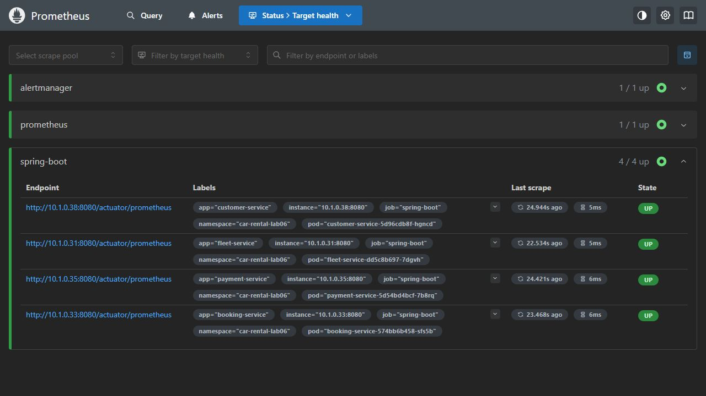
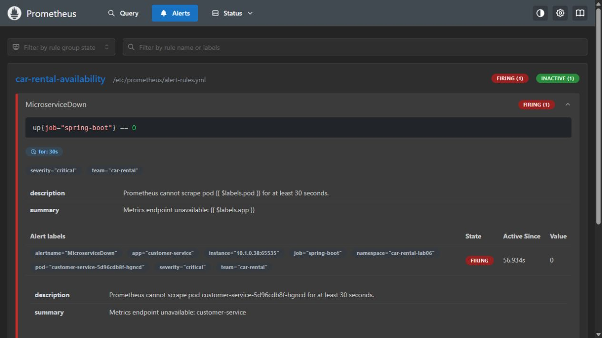
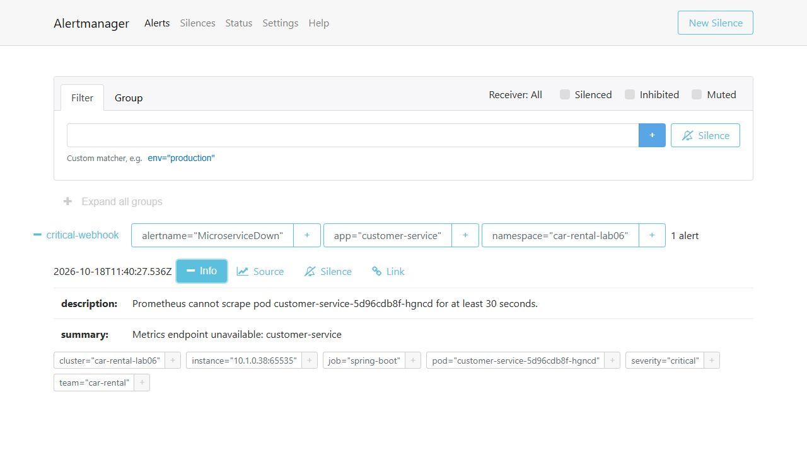
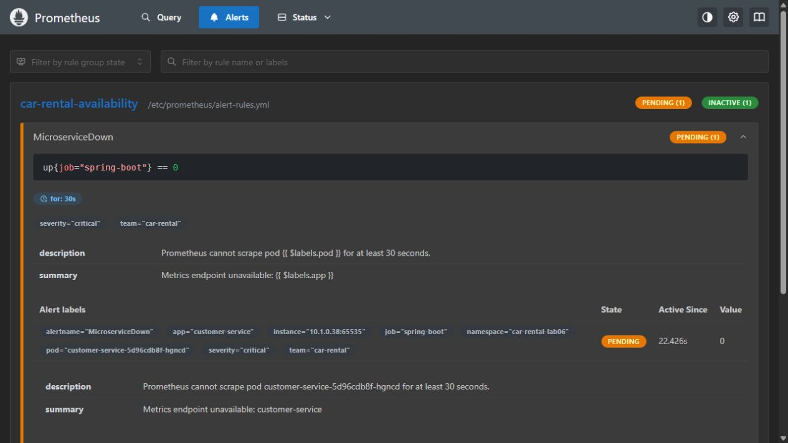

Лабораторна робота № 6

Метрики, моніторинг та алертингу розподіленій системі car-rental-service

Групове завдання. Виконали: Лис Тарас, Тарасенко Тимофій.

Звіт частково створено з допомогою ШІ.

## Мета та отриманий результат

Розгорнуто Prometheus і Alertmanager у локальному Kubernetes. В усіх чотирьох мікросервісах реалізовано Counter, Gauge, Timer, LongTaskTimer та DistributionSummary. Збережено реальні зрізи метрик, чотири targets UP, перехід Pending - Firing - Resolved і доставлені webhook-сповіщення.

| Критерій лекції, с. 62-63 | Підтвердження |

|---|---|

| Моніторинг у Kubernetes | 11 pod у car-rental-lab06: 4 API, 4 PostgreSQL, Prometheus, Alertmanager, receiver |

| Усі 5 типів метрик | Перевірено у кожному сервісі до, під час і після запитів |

| Автоматичний скрапінг | Kubernetes pod discovery; усі 4 targets UP |

| Алерт та сповіщення | MicroserviceDown Firing; critical-webhook firing і resolved |

| Код, маніфести та звіт | Архів із Helm chart, тестами, скриптами, PDF та вихідними доказами |

Середовище: Java 25.0.4.1, Spring Boot 4.1.1, Maven 3.9.11, Kubernetes v1.36.1 (Docker Desktop), Helm 3.19.0, Prometheus 3.5.0, Alertmanager 0.28.1. Усі результати нижче отримано з цього стенду, а не зі зразків лекції.

Основа роботи - наданий архів car-rental-service-main.zip та попередня лабораторна з Kafka. Код Outbox, retry, DLT та ідемпотентності збережено. У цьому запуску MESSAGING_ENABLED=false; Kafka-поведінку покривають наявні інтеграційні тести.


---


## 1. Інструментація всіх мікросервісів

Додано модуль observability та залежність micrometer-registry-prometheus. CustomerApplication, FleetApplication, BookingApplication і PaymentApplication явно імпортують ObservabilityConfiguration. ApiMetricsFilter вимірює справжні синхронні запити /api/*; actuator-запити не потрапляють у ці метрики.

| Тип | Ім’я Micrometer / експорт Prometheus | Зміст |

|---|---|---|

| Counter | car.rental.http.requests<br>car_rental_http_requests_total | Кількість завершених API-запитів. Мітки method, outcome. |

| Gauge | car.rental.http.in.flight.requests<br>car_rental_http_in_flight_requests | Поточна кількість активних запитів. AtomicInteger зберігається у bean. |

| Timer | car.rental.http.request.duration<br>car_rental_http_request_duration_seconds_* | Кількість, сумарний час, максимум та histogram завершених запитів. |

| LongTaskTimer | car.rental.http.active.requests<br>car_rental_http_active_requests_seconds_* | Кількість і тривалість запитів, які ще виконуються. |

| DistributionSummary | car.rental.http.request.body<br>car_rental_http_request_body_bytes_* | Розподіл оголошеного Content-Length у байтах; невідомі довжини пропускаються. |

У Timer і DistributionSummary увімкнено histogram та SLO-buckets. Для HTTP-метрик Spring налаштовано management.metrics.distribution.slo. Новий Prometheus registry експортує LongTaskTimer як _seconds_count, _seconds_sum, _seconds_max; count/sum тут описують активні задачі й можуть спадати. До них не застосовується rate().

Додатковий бізнес-лічильник car.rental.business.created експортується як car_rental_business_total: суфікс created обробляється registry. Він рахує створення customer, vehicle, booking і payment після commit; rollback та ідемпотентне повернення наявної сутності не збільшують значення.

Кардинальність обмежена: чотири outcome, фіксовані HTTP-методи, чотири entity та application. UUID, email, Idempotency-Key і повні URL не є мітками. У finally гарантовано зупиняється LongTaskTimer і зменшується Gauge навіть при винятку.

```
management:
  endpoints.web.exposure.include: health,prometheus,metrics
  endpoint.health.probes.enabled: true
  metrics.tags.application: ${spring.application.name}
```


---


## 2. Практична демонстрація п’яти типів

Скрипт scripts/demo_metrics.py підключився до сервісів через kubectl port-forward, створив клієнта, автомобіль, бронювання і платіж, виконав по п’ять GET запитів. Потім паралельно запустив у кожному сервісі 35-секундний /api/monitoring/demo-work. Зріз active зроблено приблизно через 12 с, after - після завершення всіх задач.

| Сервіс | Counter<br>до / після | Gauge<br>active / after | Timer<br>count / sum, с | LongTaskTimer<br>active, с | Summary<br>сума, байт |

|---|---|---|---|---|---|

| customer | 0 / 8 | 1 / 0 | 8 / 35.15 | 12.003 | 83 |

| fleet | 0 / 8 | 1 / 0 | 8 / 35.10 | 12.022 | 82 |

| booking | 0 / 7 | 1 / 0 | 7 / 35.33 | 12.041 | 159 |

| payment | 0 / 7 | 1 / 0 | 7 / 35.16 | 12.058 | 88 |

У всіх сервісах активний LongTaskTimer мав count=1, а після завершення count=0. Gauge також повернувся до нуля. Counter і Timer count збільшилися; Summary отримав ненульові JSON-розміри. Customer і fleet мають по 8 завершених запитів через додаткові виклики перевірки з booking; booking і payment - по 7. Кожен сервіс зафіксував одну бізнес-сутність.

Скрипт містить assert-перевірки ненульових приростів, активних задач, повернення Gauge/LongTaskTimer до нуля та наявності histogram buckets. Результат: PASS для всіх п’яти типів у всіх чотирьох сервісах. Дані: docs/evidence/metrics/metrics-summary.json; зразки scrape: customer-active.prom, customer-after.prom.

Фрагмент реального customer active scrape (application однаковий для наведених рядків):

```
car_rental_http_active_requests_seconds_count{application="customer-service"} 1
car_rental_http_active_requests_seconds_sum{application="customer-service"} 12.003488968
car_rental_http_in_flight_requests{application="customer-service"} 1.0
```

Автоматизована перевірка коду

Maven: BUILD SUCCESS, 46 тестів, 0 failures, 0 errors, 0 skipped; тривалість 59,144 с. Додано 6 модульних тестів observability і 4 інтеграційні HTTP-тести (по одному на сервіс). Перевірено життєвий цикл метрик, обробку винятків, транзакційні counters, обмеження demo та реальний scrape. Наявні 36 тестів попередніх робіт також пройшли.

Демонстраційний endpoint доступний лише з профілем monitoring-demo; seconds обмежено 1-120, одночасно не більше 5 задач. Це кероване навчальне навантаження. Для звичайного запуску профіль вимикають.


---


## 3. Kubernetes і автоматичний скрапінг

У namespace car-rental-lab06 працюють чотири сервіси з окремими PostgreSQL. Prometheus отримує адреси pod через Kubernetes API, опитує кожну репліку напряму та додає мітки namespace, pod, app. Скрейпінг та evaluation виконуються кожні 5 с, scrape timeout - 3 с.

| Сервіс | Фактичний endpoint | Стан |

|---|---|---|

| booking-service | 10.1.0.33:8080/actuator/prometheus | UP |

| customer-service | 10.1.0.38:8080/actuator/prometheus | UP |

| fleet-service | 10.1.0.31:8080/actuator/prometheus | UP |

| payment-service | 10.1.0.35:8080/actuator/prometheus | UP |

Вибір цілей обмежений поточним Helm release, анотацією prometheus.io/scrape=true, Running pod і портом http. Адреси не зашиті в конфігурацію. ServiceAccount має namespace Role з get/list/watch для pods; ClusterRole не потрібний. При зміні IP новий pod виявляється автоматично.

```
scrape_configs:
  - job_name: spring-boot
    metrics_path: /actuator/prometheus
    kubernetes_sd_configs:
      - role: pod
        namespaces:
          names: ["car-rental-lab06"]
```

У лекції показано ServiceMonitor для Prometheus Operator. Тут застосовано вбудований Kubernetes discovery Prometheus, який виконує вимогу автоматичного скрапінгу без встановлення Operator. Liveness використовує /actuator/health/liveness, readiness - /actuator/health/readiness.

Рис. 1. Підсумкові targets: усі чотири мікросервіси знову UP після експерименту.




---


## 4. Правила алертів і маршрутизація

| Правило | Умова | for / рівень |

|---|---|---|

| MicroserviceDown | up{job="spring-boot"} == 0 | 30 с / critical |

| MicroserviceTargetMissing | absent(up) для кожного із 4 сервісів | 2 хв / critical |

| MicroserviceHighErrorRate | 5xx / усі запити > 5%; >=20 запитів за 2 хв | 1 хв / warning |

| MicroserviceHighLatency | p95 histogram >1 с; >=20 запитів за 2 хв | 1 хв / warning |

| MicroserviceLongRunningRequest | Максимальний час активного запиту >10 с | 10 с / warning |

Error-rate та latency виключають actuator і demo маршрути. Гістограми агрегуються за le, namespace, app до histogram_quantile(0.95, ...). Умова мінімального трафіку захищає від спрацьовування на одиничному запиті. Окремий absent-алерт виявляє повне зникнення цілого сервісу з discovery, коли up=0 уже не існує.

```
groups:
  - name: car-rental-availability
    rules:
      - alert: MicroserviceDown
        expr: up{job="spring-boot"} == 0
        for: 30s
        labels:
          severity: critical
          team: car-rental
```

Alertmanager групує за alertname, namespace, app. Critical спрямовується до critical-webhook (/critical), решта - team-webhook (/alerts). Для обох receiver увімкнено send_resolved=true. group_wait=5s, group_interval=10s, repeat_interval=1h. Inhibition пригнічує warning того самого сервісу, коли активний critical про недоступність.

Receiver - окремий Python HTTP-сервіс у Kubernetes. Він приймає справжній POST від Alertmanager, пише оригінальний payload у stdout і показує останні 200 подій через /events. Це фактична доставка внутрішнього webhook-сповіщення; сторонні email/Telegram-канали у цій роботі не підключалися.

Валідація

Helm lint/template - успішно; згенерована конфігурація Prometheus валідна; promtool знайшов 5 правил; усі 7 сценаріїв promtool test rules пройшли. amtool підтвердив конфігурацію з 2 receiver і 1 inhibition rule. Журнал: docs/evidence/validation.log.


---


## 5. Експеримент: Pending - Firing - Resolved

Спочатку всі targets мали UP. Скрипт demo-alert.ps1 змінив тільки анотацію prometheus.io/port одного customer pod з 8080 на закритий порт 65535. Pod залишився у discovery, але реальний scrape отримав connection refused. Так змодельовано відмову доступу до endpoint метрик; JVM і бізнес-порт не зупинялися.

| Подія основного прогону | Київ, 18.10.2026 |

|---|---|

| Уведення відмови scrape | 14:38:16 |

| Алерт активний, стан Pending | 14:38:22 |

| Витримано for=30s; Firing | 14:38:52 |

| Receiver отримав firing | 14:38:57 |

| Умова алерту зникла після відновлення | 14:39:07 |

| Receiver отримав resolved | 14:39:17 |

Порт 8080 відновлено у finally. Усі чотири targets повернулися до UP; у фінальному Prometheus API немає активного MicroserviceDown. Події firing/resolved мають однаковий fingerprint 85da49f05f698c78, що пов’язує їх з одним інцидентом.

Рис. 2. Реальний MicroserviceDown у стані Firing.



Повний основний доказ: docs/evidence/alert/04-alert-pending.json, 05-alert-firing.json, 07-webhook-firing.json, 09-targets-recovered.json, 10-webhook-resolved.json, 12-webhook.log. Скрипт не створює штучний алерт через API Alertmanager: правило обчислюється Prometheus за фактичним результатом HTTP scrape.


---


## 6. Підтвердження доставки сповіщень

Рис. 3. Alertmanager прийняв MicroserviceDown для customer-service та вибрав critical-webhook.



Вибрані поля фактично отриманих повідомлень основного прогону:

```
{
  "firing": {
    "receivedAt": "2026-10-18T11:38:57.537920+00:00",
    "path": "/critical",
    "receiver": "critical-webhook",
    "status": "firing"
  },
  "resolved": {
    "receivedAt": "2026-10-18T11:39:17.539523+00:00",
    "path": "/critical",
    "receiver": "critical-webhook",
    "status": "resolved"
  }
}
```

Оригінальні payloads з усіма labels, annotations, startsAt, endsAt, generatorURL і fingerprint є в docs/evidence/alert/12-webhook.log та 07-webhook-firing.json / 10-webhook-resolved.json.

Під час 35-секундного навантаження також спрацьовував MicroserviceLongRunningRequest. У журналі є warning firing і resolved для fleet, booking та payment. Це додатково показує застосування LongTaskTimer до задач, що ще не завершилися. Customer у цей час був частково недоступний саме для scrape, тому його warning не використовується як доказ.


---


## 7. Відтворення та склад архіву

Потрібні JDK 25, Maven, Docker з Linux containers, робочий Kubernetes context, Helm 3, PowerShell та Python 3. Для чотирьох PostgreSQL потрібен default StorageClass. Команди виконуються з кореня розпакованого проєкту.

```
mvn -B -ntp verify
kubectl get nodes
kubectl get storageclass
./k8s/scripts/deploy-monitoring.ps1 -BuildImages
./k8s/scripts/validate-monitoring.ps1
python scripts/demo_metrics.py
./k8s/scripts/demo-alert.ps1
```

Образи збирає k8s/scripts/build-images.ps1 через Dockerfile. Для віддаленого кластера образи потрібно завантажити у registry та змінити Helm values.

| Каталог / файл | Призначення |

|---|---|

| observability/ | Спільні 5 типів метрик, business counter, bounded demo, unit tests |

| *-service/ | 4 сервіси з actuator/prometheus та HTTP integration tests |

| k8s/ | Helm chart, RBAC, discovery, alert rules, Alertmanager, receiver, тести |

| scripts/demo_metrics.py | Відтворювана перевірка метрик у Kubernetes |

| docs/evidence/metrics/, docs/evidence/alert/ | Сирі runtime-зрізи метрик, targets, алертів і webhook |

| docs/evidence/screenshots/ | Оригінальні скріншоти Pending, Firing, Alertmanager і UP |

| docs/verification/lab06/ | Maven-журнал (maven-tests.log) |

| docs/MONITORING.md, docs/report/ | Інструкція запуску та звіт PDF/Markdown |

Межі стенду

Prometheus і Alertmanager використовують emptyDir, а receiver зберігає події в пам’яті: історія втрачається при заміні pod. Докази скопійовано в архів. Стенд має одну репліку кожного сервісу і не перевіряє HA, тривале навантаження або аварійне завершення JVM. Для production потрібні постійне сховище, резервування, контроль доступу й налаштований канал чергування. DB Secrets генеруються при розгортанні та не входять до архіву.

Висновок: вимоги групового завдання перевірено на запущених сервісах. Реалізовано всі п’ять типів метрик у кожному сервісі; Prometheus автоматично опитує їх; Alertmanager доставляє сповіщення про реальний scrape-збій та його усунення.


---


## 8. Джерела та перевірюваність результатів

Вимоги: надана «Лекція 6 (1).pdf», с. 62-63; технічний контекст метрик, discovery і алертингу - с. 13-30, 55-57. Вихідна реалізація: надані car-rental-service-main.zip та KAFKA_REPORT.md.

Spring Boot Actuator: Metricshttps://docs.spring.io/spring-boot/reference/actuator/metrics.html

Micrometer: Long Task Timershttps://docs.micrometer.io/micrometer/reference/concepts/long-task-timers.html

Micrometer: Prometheushttps://docs.micrometer.io/micrometer/reference/implementations/prometheus.html

Prometheus: Kubernetes discoveryhttps://prometheus.io/docs/prometheus/latest/configuration/configuration/#kubernetes_sd_config

Prometheus: Unit testing ruleshttps://prometheus.io/docs/prometheus/latest/configuration/unit_testing_rules/

Alertmanager: Configurationhttps://prometheus.io/docs/alerting/latest/configuration/

Докази не є макетами: скріншоти отримано з вебінтерфейсів працюючого Prometheus/Alertmanager; JSON і .prom збережено з API та HTTP endpoint; webhook.log знято через kubectl logs. Дані в таблицях автоматично прочитано генератором звіту з цих файлів. Події основного прогону і повтору для скріншотів зберігаються окремо.

Рис. 4. Проміжний стан Pending: for=30s ще не завершився. Це відрізняє появу умови від підтвердженого Firing.



Коротка інструкція зупинки навчального стенду: helm uninstall car-rental-lab06 -n car-rental-lab06. Видалення namespace/PVC знищує навчальні дані й у межах цієї роботи не виконувалося. Поточний стенд залишено запущеним; сценарій збою завершено відновленням.