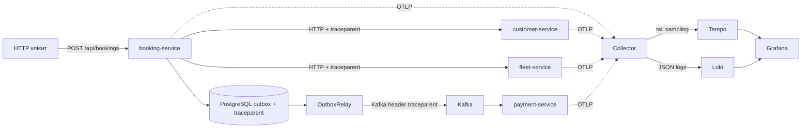
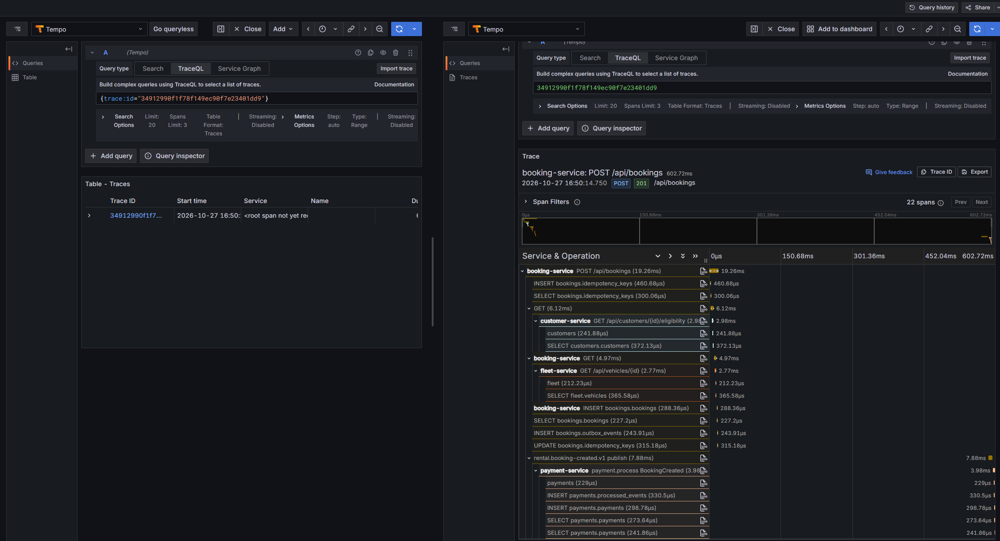
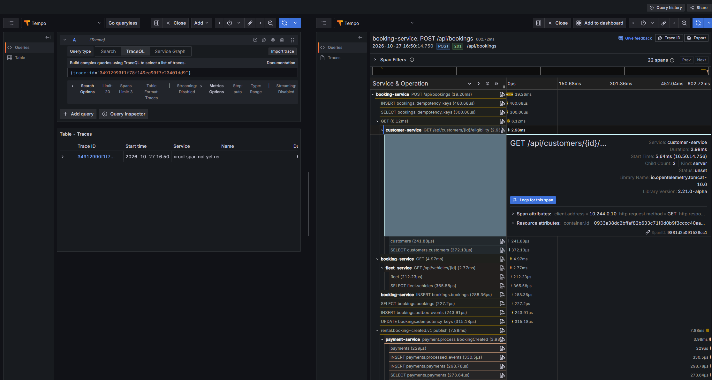
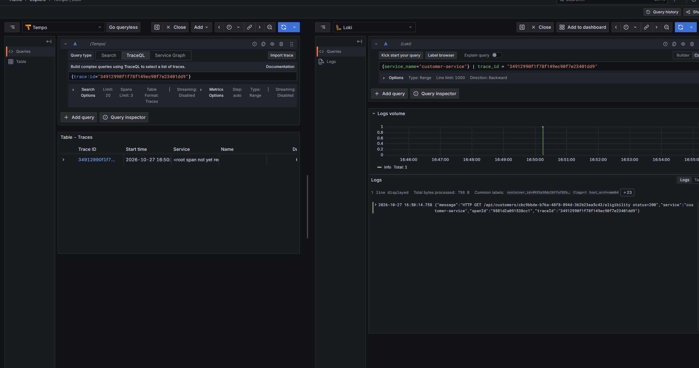
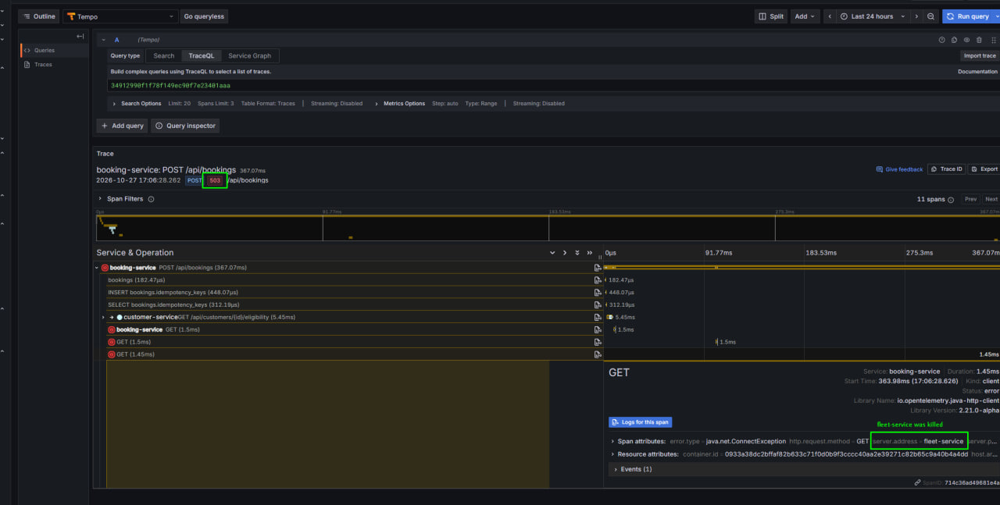

# Лабораторна робота 7. Розподілене трасування Car Rental

Командний проєкт: сервіс оренди автомобілів.
Команда:
Лис Тарас Олександрович
Тарасенко Тимофій Миколайович

Звіт створено за допомогою ШІ

## 1. Мета та виконане розгортання

У Kubernetes Docker Desktop створено окремий namespace `car-rental-lab07`. У ньому розгорнуто чотири Spring Boot мікросервіси з окремими PostgreSQL, Kafka у режимі KRaft, OpenTelemetry Collector Contrib, Grafana Tempo, Grafana Loki та Grafana. Підсумковий стан pod наведено у `../evidence/lab07/kubernetes.txt`.

Версії: Java 25, Spring Boot 4.1.1, Java agent 2.21.0, Collector 0.135.0, Tempo 2.8.2, Loki 3.5.5, Grafana 12.1.1, Kafka 4.0.0. Конфігурації зберігаються у `k8s/files/tracing`, ресурси — у `k8s/templates`, параметри лабораторного стенду — у `k8s/values.tracing.yaml`. Для Tempo у Helm піднято ліміт пам’яті до 1 Gi: за 512 Mi спостерігався `OOMKilled`, через що Grafana показувала Bad Gateway під час запитів.

## 2. Архітектура та передавання контексту



Java agent інструментує вхідні HTTP-запити, вихідні HTTP-клієнти, JDBC і Kafka producer. `OTEL_PROPAGATORS=tracecontext,baggage` вмикає W3C Trace Context, `OTEL_TRACES_SAMPLER=always_on` передає всі спани колектору для хвостового рішення.

Для відкладеного надсилання недостатньо thread-local контексту HTTP-запиту. `OutboxRepository` у тій самій транзакції, що й бронювання, зберігає `traceparent`. Міграція `ADD COLUMN IF NOT EXISTS` сумісна з наявною таблицею. `OutboxRelay` відновлює цей контекст через `W3CTraceContextPropagator` / `TraceCarrier`, додає header повідомлення, а agent створює дочірній producer span. Після надсилання scope закривається, тому наступна подія не успадковує чужий трейс.

`BookingEventListener` явно видобуває останній `traceparent` з headers та створює consumer span `payment.process BookingCreated`. При винятку він записує exception і статус ERROR; завершення span гарантоване у finally. Некоректний або порожній header не спричиняє збій обробки. Outbox зберігає саме traceparent; довільний baggage через БД не переноситься.

## 3. Collector і хвостовий семплінг

OTLP приймається на `0.0.0.0:4317` (gRPC) і `0.0.0.0:4318` (HTTP). Трейси проходять послідовність `memory_limiter → tail_sampling → batch → otlp/tempo`. Логи йдуть окремим pipeline `memory_limiter → transform/json_logs → batch → otlphttp/loki`.

Політика `all-errors` зберігає трейси, що мають span зі статусом ERROR. `decision_wait=60s`, місткість — 20000 трейсів, cache позитивних рішень — 100000. Collector має одну репліку: всі спани одного traceId потрапляють до одного процесу.

У демонстраційному профілі baseline дорівнює **100%**, щоб успішний сценарій гарантовано залишався доступним для захисту. Хвостовий процесор увімкнений, але профіль не зменшує кількість успішних трейсів. Для вибіркового збереження успіхів можна знизити `sampling_percentage`; політика ERROR лишається незалежною.

Обіцянка збереження всіх помилок діє для спанів, доставлених до працездатного Collector у межах `decision_wait` і ресурсів. У стенді немає дискової черги OTLP; дані Tempo/Loki лежать у emptyDir.

## 4. JSON-логи та Grafana

Spring Boot виводить JSON у форматі logstash; поля MDC перейменовано на `traceId` і `spanId`. Agent також передає log records через OTLP. Collector збирає в body об’єкт із `message`, `service`, `traceId`, `spanId` і надсилає його до Loki `/otlp`. У Loki `service_name` — label, `trace_id` — structured metadata.

Приклад LogQL:

```logql
{service_name="payment-service"} | trace_id = "dffa5f08ae2b46c6ba34ad5731c66709"
```

Provisioning Tempo містить `tracesToLogsV2` (datasourceUid `loki`, `service.name → service_name`, ±5 хв). Кнопка **Logs for this span** у Grafana будує окремий LogQL-запит до Loki за `traceId` зі спана — це не join усередині Tempo.

**UI-перевірка виконана.** Після зміни пароля admin підтверджено перехід від спана до логів. Скріншоти:

| Файл | Зміст |
|------|--------|
| `../evidence/success-trace.png` | Дерево успішного трейсу (HTTP + Kafka + payment) |
| `../evidence/logs-for-span-1.png` | Перехід Tempo → Loki (**Logs for this span**) |
| `../evidence/logs-for-span-2.png` | Корельовані логи з узгодженим `traceId` |
| `../evidence/incident-trace.jpg` | Інцидент: ERROR на корені та клієнтських GET до fleet |







## 5. Наскрізний бізнес-сценарій

Створено клієнта й автомобіль, виконано `POST /api/bookings`, дочекано створення платежу Kafka consumer (прямий POST платежу не викликався). Відтворення зручно робити через локальний `scripts/demo_tracing.py` або вручну з port-forward сервісів.

Канонічний evidence-traceId: `dffa5f08ae2b46c6ba34ad5731c66709`.

Перевірено: **20 span, 4 сервіси, 1 корінь дерева**. Корінь — `POST /api/bookings`. HTTP-виклики customer і fleet є його нащадками. Kafka producer `rental.booking-created.v1 publish` має parent бронювання, а `payment.process BookingCreated` — parent producer. JDBC-спани показують каталоги, бронювання, outbox і платіж.

Докази API: `scenario.json`, `payments.json`, `trace.json`, `trace-summary.json` і чотири `*-logs.json` у `docs/evidence/lab07`.

## 6. Діагностичний цикл

Інцидент відтворено **вручну** у namespace `car-rental-lab07`:

1. `kubectl -n car-rental-lab07 scale deployment/fleet-service --replicas=0`
2. Повторний `POST /api/bookings` з наявними `customerId` / `vehicleId` → HTTP **503** (`Fleet returned an empty response`)
3. `kubectl -n car-rental-lab07 scale deployment/fleet-service --replicas=1`

У Tempo корінь показує 503; причину видно в **дочірніх** client-spans `GET` з `server.address=fleet-service`, `url.full=http://fleet-service:8080/api/vehicles/...` та `error.type=java.net.ConnectException` (Resilience4j робить кілька спроб). Після fallback booking відповідає 503; деталі — у логах booking через **Logs for this span**.

Збережені артефакти API: `incident.json`, `incident-trace.json`, `incident-summary.json` (traceId `38fdfa68346b46d9aac245ad0209ddd6`). Візуальний доказ розслідування — `../evidence/incident-trace.jpg`.



Послідовність розслідування: Tempo → ERROR на GET до fleet → порівняти з успішним customer → логи booking → відновити репліку fleet → повторити успішний сценарій.

## 7. Валідація й відтворення

Maven verify: **48 тестів, 0 failures; BUILD SUCCESS**. Helm lint — успішно. Журнали й згенеровані маніфести — у `docs/evidence/lab07`.

```powershell
mvn -B -ntp verify
./k8s/scripts/deploy-tracing.ps1
# образи з тегом lab07; secrets через create-secrets.ps1
kubectl -n car-rental-lab07 port-forward svc/grafana 3000:3000
```

Успішний сценарій і інцидент можна відтворити вручну (port-forward API-сервісів + scale fleet) або локальними демо-скриптами. Grafana: http://localhost:3000 (перший вхід admin/admin зі зміною пароля). Стенд розрахований на Docker Desktop зі спільним image store.

## 8. Межі

Tempo, Loki, Grafana і Kafka — навчальні одноекземплярні компоненти з emptyDir: перезапуск pod знищує історію трейсів/логів і сесію Grafana. Retention Tempo — 24 год (`block_retention`). PostgreSQL на PVC. Для продакшену потрібні постійне сховище, автентифікація, TLS і контроль затримки outbox.

## Джерела

- [W3C Trace Context](https://www.w3.org/TR/trace-context/)
- [OpenTelemetry tail sampling processor](https://github.com/open-telemetry/opentelemetry-collector-contrib/tree/main/processor/tailsamplingprocessor)
- [Grafana trace-to-logs](https://grafana.com/docs/grafana/latest/datasources/tempo/configure-tempo-data-source/configure-trace-to-logs/)
- [Grafana provisioning і екранування змінних](https://grafana.com/docs/grafana/latest/administration/provisioning/)
